 

 

## `~/about`

I'm a full-stack developer based in Nairobi, strongest on the backend. I graduated in August 2026 with a BSc in Computer Science from the University of Embu, Second Class Honours (Upper Division).

I also work as a junior IFS Cloud consultant on procurement and supply chain, and I do IT support: troubleshooting Windows PCs, installing software, and setting up routers and switches. I'm looking for full-stack, backend, ERP consulting or IT roles.

## `~/skill-set`

| | |
|---|---|
| **Languages** |  |
| **Backend** |    |
| **Frontend** |  |
| **Machine learning** |   |
| **Databases** |   |
| **Tools** |  |
| **ERP consulting** | IFS Cloud: Procurement, Supply Chain |
| **IT support** | Windows, installations, routers and switches |

IFS Certified Practitioner, Procurement Consultant (IFS Cloud). Currently learning penetration testing through Cisco Networking Academy.

